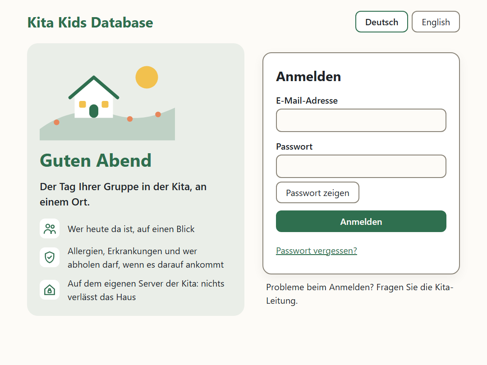
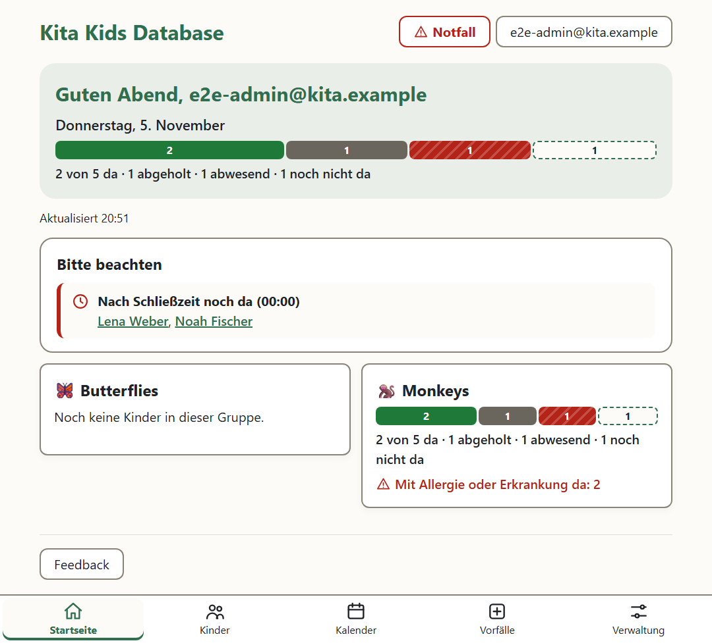
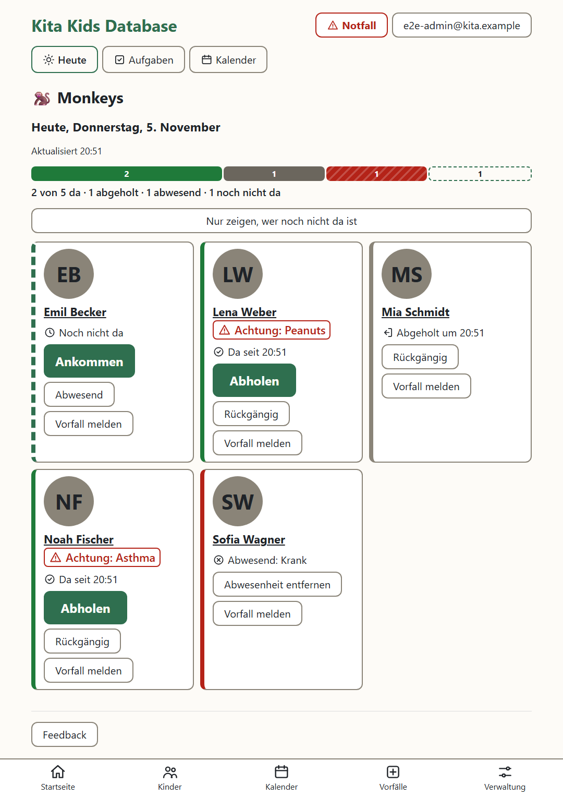
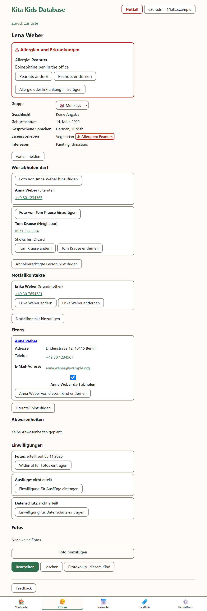
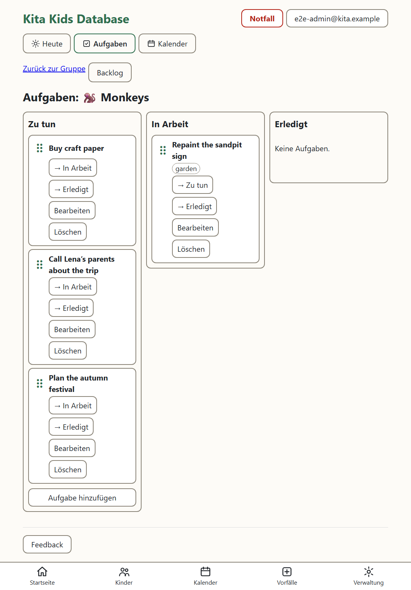
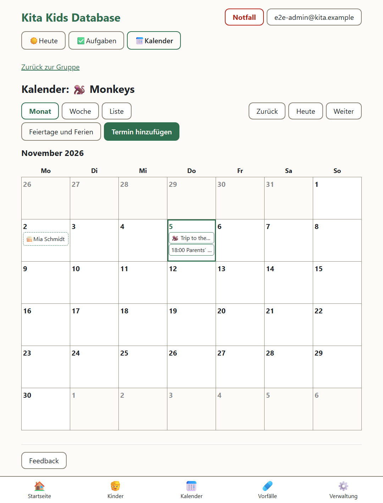
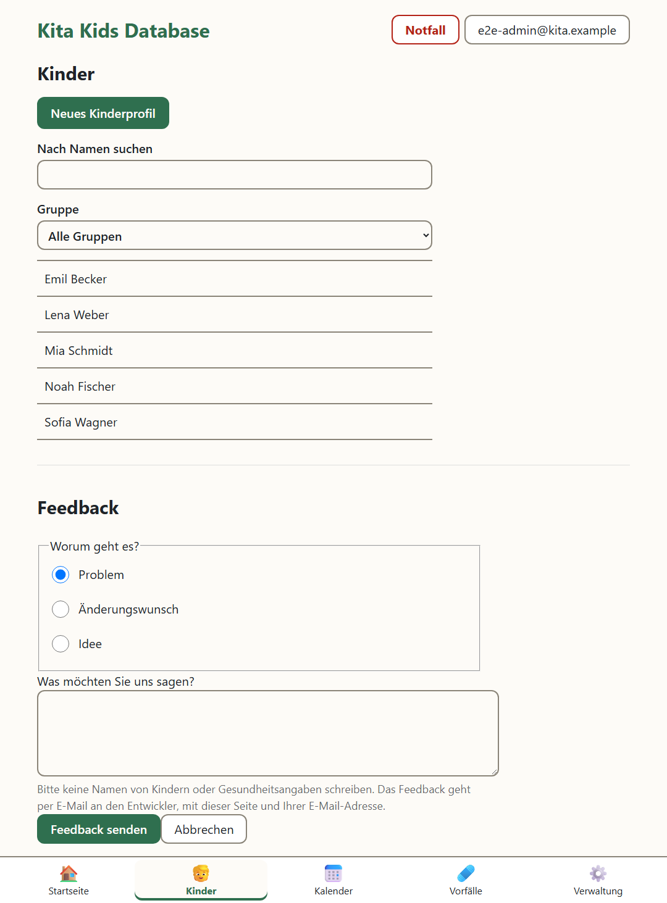
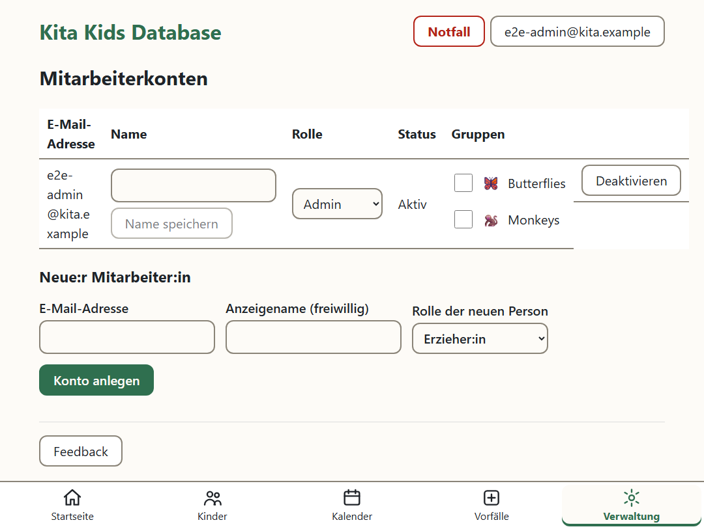

# Handbuch

Für alle in der Kita, die mit der App arbeiten. Teil 1 ist für alle Mitarbeiter:innen, Teil 2 nur für Admins. Die Bilder zeigen die App auf einem Tablet, mit erfundenen Kindern.

## Teil 1: Alle Mitarbeiter:innen

### Anmelden

Die App vom Startbildschirm des Tablets öffnen (oder `https://kita.home.arpa` im Browser). Mit Ihrer E-Mail-Adresse und Ihrem Passwort anmelden. „Passwort zeigen“ zeigt, was Sie getippt haben; nach dem Anmelden ist es wieder verborgen. „Deutsch“ oder „English“ oben wechselt die Sprache; das Tablet merkt sie sich.

- **Ihr Konto.** Eine Admin legt es an; Sie bekommen eine E-Mail mit einem Link (7 Tage gültig). Folgen Sie ihm und wählen Sie ein Passwort mit mindestens 12 Zeichen.
- **Passwort vergessen?** „Passwort vergessen?“ auf der Anmeldeseite schickt Ihnen einen Link (1 Stunde gültig).
- **Gesperrt?** Nach 5 falschen Passwörtern hintereinander ist das Konto 15 Minuten gesperrt. Ein neues Passwort, oder eine Admin („Entsperren“ unter Mitarbeiterkonten), hebt die Sperre sofort auf. Nach 20 fehlgeschlagenen Anmeldungen von einem Tablet in 10 Minuten muss dieses Tablet bis zu 10 Minuten warten.
- **Von selbst abgemeldet?** Nach 30 Minuten ohne Tippen meldet die App Sie ab, damit ein liegen gelassenes Tablet nichts zeigt. Einfach wieder anmelden.
- Immer „Abmelden“, bevor Sie ein Tablet weitergeben: oben rechts auf Ihren Namen tippen, dann „Abmelden“. Im selben Menü stellen Sie die Sprache um.
- **Zurechtfinden:** Die Leiste unten am Tablet (am Büro-PC: links) hat Startseite, Kinder, Kalender und Vorfälle; Admins haben auch Verwaltung. In einer Gruppe stehen oben ihre Reiter Heute, Aufgaben und Kalender. **„Notfall“** steht oben auf jeder Seite.

### Der Tag Ihrer Gruppe

Nach dem Anmelden sind Sie dort, wo Ihr Tag ist. Arbeiten Sie in einer Gruppe, öffnet sich ihr „Heute“ von selbst. Arbeiten Sie in mehreren, zeigt die Startseite für jede eine Kachel mit den Zahlen von heute: auf Ihre tippen. Admins sehen die Übersicht der Kita. Sie begrüßt Sie mit Namen und zeigt den Tag der ganzen Kita als Balken, dann die Kachel jeder Gruppe. **„Bitte beachten“** zeigt, worum man sich heute kümmern sollte: Kinder, die nach Schließzeit noch da sind, Kinder ohne Gruppe, die Vorfälle von heute und die Geburtstage. Die Zahlen aktualisieren sich alle paar Minuten von selbst („Aktualisiert 09:42“).

Die Seite der Gruppe zeigt den heutigen Tag: wie viele Kinder da, abgeholt, abwesend oder noch nicht da sind; die Geburtstage von heute; und jedes Kind mit seinem Stand.

- **„Ankommen“**, wenn ein Kind kommt. **„Abholen“**, wenn es abgeholt wird: zuerst zeigt die App, wer das Kind abholen darf, mit Fotos; die Person an der Tür prüfen, dann **„Geht jetzt nach Hause“** („Nicht jetzt“, wenn es jemand anderes ist). Falsch getippt? **„Rückgängig“**.
- **„Nur zeigen, wer noch nicht da ist“**: morgens nur die Kinder, die noch kommen.
- **„Abwesend“**: der Grund (krank, Urlaub, anderes) und von wann bis wann. Es erscheint auf dem Profil des Kindes; „Abwesenheit entfernen“ nimmt es zurück.
- Das Zeichen **„Achtung“** neben einem Namen heißt: eine Allergie oder Erkrankung. Auf den Namen tippen, um sie zu sehen.

### Das Profil eines Kindes

Auf den Namen eines Kindes tippen (auf der Seite der Gruppe, oder unter „Kinder“, wo man nach Namen suchen kann). Oben, rot: seine **Allergien und Erkrankungen**, mit dem, was zu tun ist. Darunter: Essensvorlieben (mit den Allergien daneben), Sprachen, Interessen, Eltern, **Notfallkontakte** und **wer abholen darf**, mit Fotos.

**Beim Abholen:** die Person mit „Wer abholen darf“ und ihrem Foto vergleichen. Steht sie nicht dort, geht das Kind nicht mit: einen Elternteil anrufen.

Nur Admins ändern Profile. Stimmt etwas nicht oder fehlt etwas, einer Admin sagen.

### Fotos

Die Fotos eines Kindes erscheinen nur, solange die Foto-Einwilligung der Eltern erteilt ist. Ohne sie zeigt die App keine Fotos und nimmt keine auf.

### Ein Unfall oder Vorfall

Auf dem Profil des Kindes oder der Seite der Gruppe: **„Vorfall melden“**. Datum (und Uhrzeit, wenn bekannt), was passiert ist und wer informiert wurde (z. B. „Mutter, telefonisch“). Einmal gespeichert, lässt er sich nicht mehr ändern; eine Admin kann Nachträge hinzufügen. Ihr „Vorfallbuch“ zeigt die Vorfälle, die Sie gemeldet haben.

### Die Notfallliste

Für eine Feuerübung, eine Räumung, oder wenn Strom oder Netz ausfallen könnten: **„Notfallliste (PDF)“** über **„Notfall“** oben auf jeder Seite: die Liste der Gruppe, in der Sie sind, oder **„Notfallliste der ganzen Kita (PDF)“**. Sie zeigt die Kinder, die gerade da sind (angekommen, noch nicht abgeholt), mit ihren Allergien und Erkrankungen und wen man anruft. Drucken, oder auf dem Tablet öffnen.

### Die Aufgaben

In der Gruppe der Reiter **„Aufgaben“**. „Aufgabe hinzufügen“, dann mit dem Finger zwischen Zu tun, In Arbeit und Erledigt ziehen (oder die Schaltflächen nutzen). „Bearbeiten“ legt fest, wer es macht, ein Fälligkeitsdatum und Schlagwörter. **„Backlog“** zeigt die Aufgaben unter Zu tun nach Wichtigkeit: ziehen, oder „Hoch“ und „Runter“.

### Der Kalender

„Kalender“ in der Leiste unten (die ganze Kita) oder der Reiter „Kalender“ der Gruppe (diese Gruppe). Monat, Woche oder Liste. Er zeigt die Termine, die Feiertage und Schulferien und die Geburtstage der Kinder.

„Termin hinzufügen“: ein Titel, für die Gruppe oder die ganze Kita, ganztägig oder mit Uhrzeiten, auf Wunsch mit Wiederholung, und eine Erinnerung. Eine Erinnerung ist eine E-Mail ab 07:00 am selben Morgen, oder 1, 2 oder 7 Tage vorher, an alle Mitarbeiter:innen, die in dieser Gruppe arbeiten (oder, für die ganze Kita, an alle Mitarbeiter:innen; nie an Gäste).

### Feedback

Etwas stimmt nicht, ist schwierig, oder eine Idee? **„Feedback“**, auf jeder Seite. Problem, Änderungswunsch oder Idee wählen, schreiben, senden. Es geht an den Entwickler, mit der Seite, auf der Sie waren. **Bitte keine Namen von Kindern und keine Gesundheitsangaben** hineinschreiben.

## Teil 2: Admins

### Mitarbeiterkonten

„Mitarbeiterkonten“ listet alle mit einer Anmeldung, ihre Rolle und ihren Status.

- **Neue Kollegin:** „Neue:r Mitarbeiter:in“: E-Mail-Adresse und Rolle, dann „Konto anlegen“. Sie bekommt die Einladung per E-Mail. Nicht angekommen? „Neuen Link senden“.
- **Rollen:** *Admin* (alles), *Erzieher:in* (der Alltag: liest Profile, Ankommen und Abholen, Abwesenheiten und Vorfälle, Aufgaben und Termine; ändert kein Profil), *Gast* (nur die Termine der ganzen Kita und die Feiertage im Kalender, und Feedback; kein Kind, keine Geburtstage).
- **Gruppen:** bei allen Erzieher:innen die Gruppen ankreuzen, in denen sie arbeiten. Sie sehen ihre Gruppen zuerst, können deren Aufgaben bekommen und erhalten deren Erinnerungen.
- **Jemand geht:** „Deaktivieren“, am selben Tag. Sie ist sofort draußen; ihr Verlauf bleibt. „Reaktivieren“ lässt sie wieder herein.
- Die Kita hat immer mindestens eine aktive Admin; niemand kann das eigene Konto deaktivieren.

### Gruppen

„Verwaltung“ → „Gruppen“: eine mit Namen und Symbol anlegen, umbenennen, oder entfernen („Endgültig entfernen“; ihre Kinder bleiben, ohne Gruppe).

### Kinderprofile

„Kinder“ → **„Neues Kinderprofil“**: Name, Geburtsdatum, Geschlecht, Sprachen, Essensvorlieben, Interessen. Dann, auf dem Profil:

- die **Gruppe**,
- **„Allergie oder Erkrankung hinzufügen“**: Art, wogegen allergisch (oder die Erkrankung), und was zu tun ist,
- **Eltern**: „Elternteil hinzufügen“, oder einen schon eingetragenen suchen (für Geschwister) und „Verknüpfen“; ankreuzen, ob er abholen darf,
- **„Notfallkontakt hinzufügen“** und **„Abholberechtigte Person hinzufügen“**, mit einem Foto der Person,
- **Einwilligungen** (Fotos, Ausflüge, Datenschutz): eintragen, wann jede erteilt wurde, und wann widerrufen. Ein Widerruf der Foto-Einwilligung verbirgt die Fotos des Kindes sofort,
- **Fotos**: „Foto hinzufügen“ (nur mit Foto-Einwilligung).

„Bearbeiten“ ändert das Profil. Aktuell halten: Die Notfallliste ist nur so gut wie die Profile.

### Feiertage und Ferien

„Kalender“ → „Feiertage und Ferien“: die Feiertage und Schulferien der Region aus .ics-Dateien übernehmen (z. B. von einer Ferien-Website). Jede Übernahme ersetzt die bisherigen ihrer Art; einmal im Jahr.

### Das Vorfallbuch

„Vorfallbuch“ zeigt alle Vorfälle, die neuesten zuerst, gefiltert nach Kind, Gruppe oder Daten. „Nachtrag hinzufügen“ hält fest, was danach geschah.

### Wenn ein Kind geht: das Archiv

„Löschen“ auf dem Profil verschiebt das Kind ins **Archiv**, getrennt von den aktuellen Kindern. Von dort kann eine Admin es mit allen Daten **„Wiederherstellen“**, bis es nach der Aufbewahrungsfrist (12 Monate) **endgültig gelöscht** wird. Das Archiv zeigt das Datum jeder Löschung.

### Datenschutz-Anfragen

Auf der Seite eines Elternteils (auf seinen Namen im Profil eines Kindes tippen):

- **„Alle Daten exportieren (ZIP)“**: alles, was über den Elternteil und seine Kinder eingetragen ist, mit Fotos, um eine Auskunftsanfrage zu beantworten.
- **„Alle Daten löschen“** → **„Endgültig löschen“**: löscht den Elternteil und seine Kinder endgültig, auch archivierte und ihre Fotos; die anderen Eltern der Kinder ebenfalls, wenn sie kein anderes Kind haben. **Das lässt sich nicht rückgängig machen**; nur für eine Löschanfrage.

Die Sicherungen behalten gelöschte Daten noch bis zu 8 Wochen.

### Das Protokoll

„Protokoll“ zeigt, wer wann welche Daten welches Kindes angesehen oder geändert hat: nach Mitarbeiter:in, Aktion und Daten filtern. Auf einem Profil zeigt „Protokoll zu diesem Kind“ nur seine.

### Der Server

Der Server, die Sicherungen und was zu tun ist, wenn eine Warn-E-Mail kommt: das Betriebshandbuch (`docs/server`), gedruckt im Büro.
