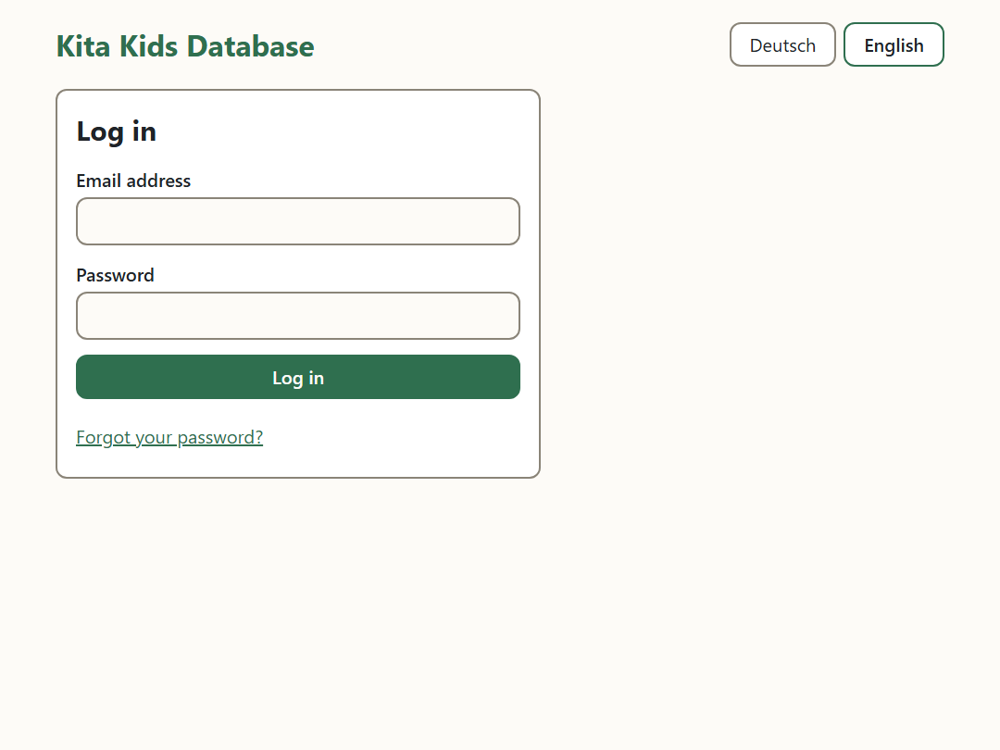
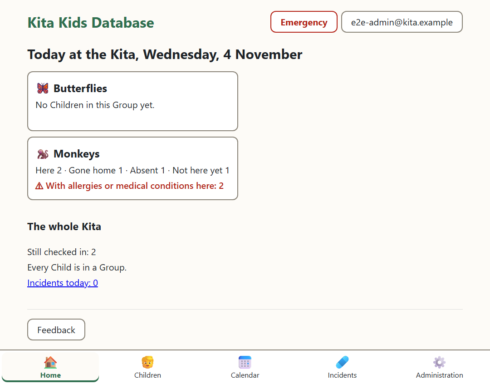
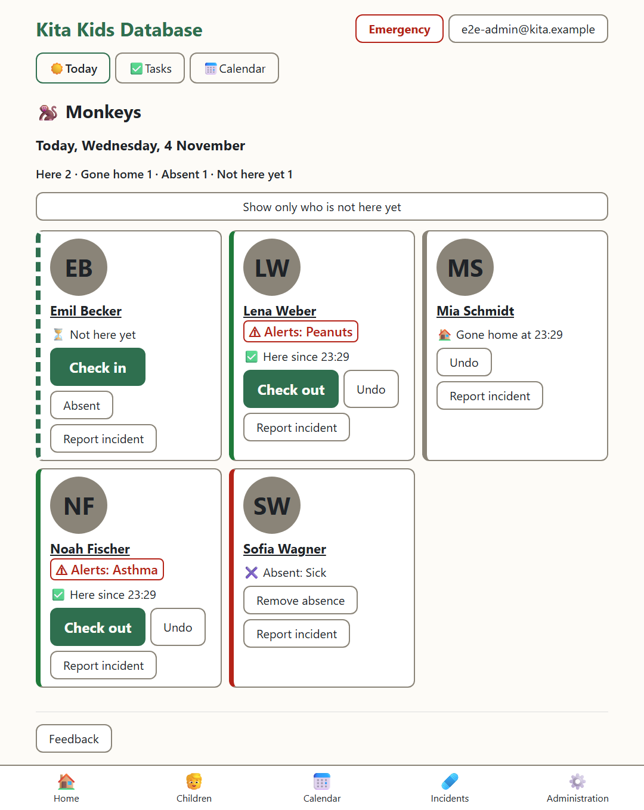
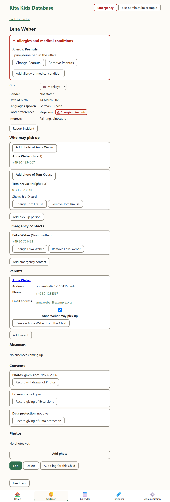
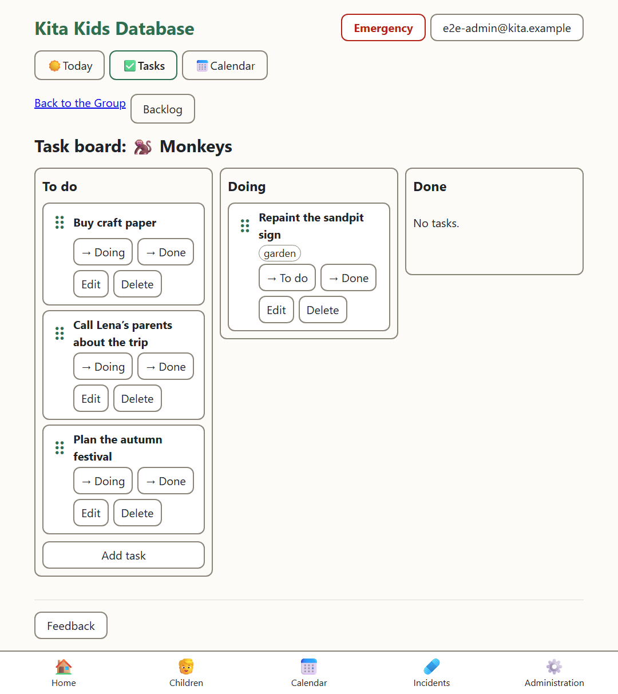
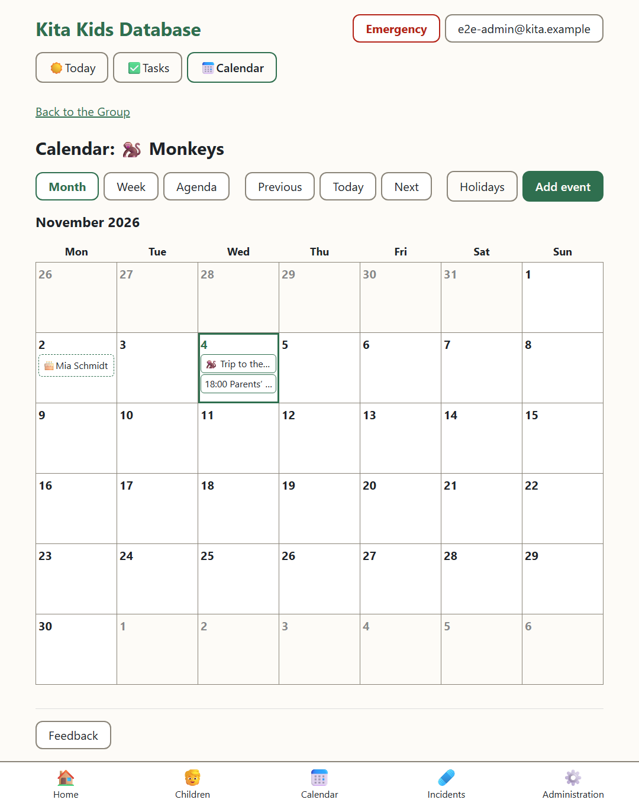
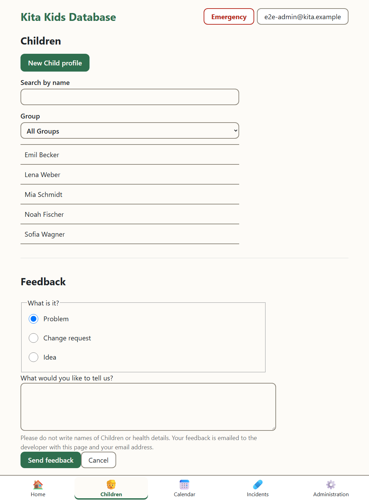
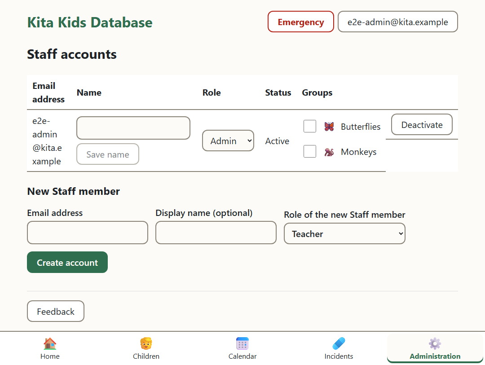

# User manual

For everyone at the Kita who works with the app. Part 1 is for every Staff member, part 2 only for Admins. The pictures show the app on a tablet, with made-up Children.

## Part 1: Every Staff member

### Logging in

Open the app from the tablet's home screen (or `https://kita.home.arpa` in the browser). Log in with your email address and your password. "Deutsch" or "English" at the top switches the language; the tablet remembers it.

- **Your account.** An Admin creates it; you get an email with a link (valid for 7 days). Follow it and choose a password of at least 12 characters.
- **Forgotten your password?** "Forgot your password?" on the login page sends you a link (valid for 1 hour).
- **Locked out?** After 5 wrong passwords in a row the account is locked for 15 minutes. Choosing a new password, or an Admin ("Unlock" on the Staff accounts page), unlocks it at once. After 20 failed logins from one tablet within 10 minutes, that tablet must wait up to 10 minutes.
- **Logged out by itself?** After 30 minutes without a tap the app logs you out, so a tablet left lying around shows nothing. Just log in again.
- Always "Log out" when you hand a tablet to someone else: tap your name at the top right, then "Log out". The same menu changes the language.
- **Finding your way:** the bar at the bottom of the tablet (on the office PC: down the left) has Home, Children, Calendar and Incidents; Admins also have Administration. Inside a Group, its tabs Today, Tasks and Calendar are at the top. **"Emergency"** is at the top of every page.

### Your Group's day

After logging in you are where your day is. If you work in one Group, its Today view opens by itself. If you work in several, Home shows a tile for each with today's counts: tap yours. Admins see the Kita overview: every Group's day, who is still checked in, Children in no Group, and today's Incidents.

The Group's page shows today: how many Children are here, gone home, absent or not here yet; today's birthdays; and every Child with their state.

- **"Check in"** when a Child arrives. **"Check out"** when they are picked up: first it shows who may pick the Child up, with photos; check the person at the door, then **"Goes home now"** ("Not now" if it is someone else). Tapped the wrong one? **"Undo"**.
- **"Show only who is not here yet"**: in the morning, only the Children still to come.
- **"Absent"**: the reason (sick, holiday, other) and from when until when. It shows on the Child's profile; "Remove absence" takes it back.
- The **"Alerts"** marker next to a name means an allergy or medical condition. Tap the name to see it.

### A Child's profile

Tap a Child's name (on the Group's page, or under "Children", where you can search by name). At the top, in red: their **allergies and medical conditions**, with what to do. Below: food preferences (with the allergies next to them), languages, interests, Parents, **Emergency contacts** and **who may pick up**, with photos.

**At pick-up:** check the person against "Who may pick up" and their photo. If they are not there, the Child does not go with them: call a Parent.

Only Admins change profiles. If something is wrong or missing, tell an Admin.

### Photos

A Child's photos show only while their Parents' photo Consent is given. Without it, the app shows no photos and takes none.

### An accident or incident

On the Child's profile or the Group's page: **"Report incident"**. Write the date (and time if known), what happened, and who was informed (e.g. "mother, by phone"). Once saved it cannot be changed; an Admin can add follow-ups. Your "Incident log" shows the incidents you reported.

### The emergency list

For a fire drill, an evacuation, or when the power or network may go: **"Emergency"** at the top of every page → **"Emergency list (PDF)"** of the Group you are in, or **"Emergency list of the whole Kita (PDF)"**. It lists the Children here right now (checked in, not yet checked out), with their allergies and conditions and whom to call. Print it, or open it on the tablet.

### The Task board

In the Group, the **"Tasks"** tab. "Add task", then drag it with a finger between To do, Doing and Done (or use the buttons). "Edit" sets who does it, a due date and labels. **"Backlog"** shows the To do tasks in order of importance: drag them, or use "Up" and "Down".

### The Calendar

"Calendar" in the bar at the bottom (the whole Kita), or the Group's "Calendar" tab (that Group). Month, Week or Agenda. It shows the Events, the public and school holidays, and the Children's birthdays.

"Add event": a title, for the Group or the whole Kita, all day or with times, repeating if wanted, and a Reminder. A Reminder is an email from 07:00 that morning, or 1, 2 or 7 days before, to every Staff member working in that Group (or, for the whole Kita, to every Staff member; never to Guests).

### Feedback

Something wrong, hard, or an idea? **"Feedback"**, on every page. Choose problem, change request or idea, write it, send. It goes to the developer with the page you were on. **No names of Children and no health details** in it, please.

## Part 2: Admins

### Staff accounts

"Staff accounts" lists everyone with a login, their Role and status.

- **New colleague:** "New Staff member": their email address and Role, then "Create account". They get the invitation email. Not arrived? "Send new link".
- **Roles:** *Admin* (everything), *Teacher* (everyday work: reads profiles, checks in and out, records Absences and Incidents, Tasks and Events; changes no profile), *Guest* (only the Calendar's Kita-wide Events and holidays, and Feedback; no Child at all, no birthdays).
- **Groups:** tick the Groups each Teacher works in. They see their Groups first, can be given their Tasks, and get those Groups' Reminders.
- **Someone leaves:** "Deactivate", the same day. They are out at once; their history stays. "Reactivate" lets them back.
- The Kita always keeps at least one active Admin; nobody can deactivate their own account.

### Groups

"Administration" → "Groups": create one with a name and an icon, rename it, or remove it ("Remove for good"; its Children stay, in no Group).

### Child profiles

"Children" → **"New Child profile"**: name, date of birth, gender, languages, food preferences, interests. Then, on the profile:

- the **Group**,
- **"Add allergy or medical condition"**: kind, what they are allergic to (or the condition), and what to do,
- **Parents**: "Add Parent", or find one already recorded (for Siblings) and "Link" them; tick whether they may pick up,
- **"Add emergency contact"** and **"Add pick-up person"**, with a photo of the person,
- **Consents** (photos, excursions, data protection): record when each was given, and when withdrawn. Withdrawing the photo Consent hides that Child's photos at once,
- **Photos**: "Add photo" (only with photo Consent).

"Edit" changes the profile. Keep it current: the emergency list is only as good as the profiles.

### Holidays

"Calendar" → "Holidays": import the region's public holidays and school holidays from .ics files (e.g. from a holiday website). Each import replaces the holidays of its kind; do it once a year.

### The incident log

"Incident log" shows every incident, newest first, filtered by Child, Group or dates. "Add follow-up" records what happened next.

### When a Child leaves: the Archive

"Delete" on the profile moves the Child to the **Archive**, apart from the current Children. From there an Admin can **"Restore"** them with all their data, until they are **purged for good** after the retention period (12 months). The Archive shows the date of each purge.

### Data-protection requests

On a Parent's page (tap their name on a Child's profile):

- **"Export all data (ZIP)"**: everything recorded about the Parent and their Children, with photos, to answer a data-access request.
- **"Delete all data"** → **"Delete permanently"**: deletes the Parent and their Children for good, archived ones and photos too; the Children's other Parents go too if they have no other Child. **This cannot be undone**; only for a deletion request.

Backups keep deleted data for up to 8 weeks more.

### The Audit log

"Audit log" shows who viewed or changed which Child's data, and when: filter by Staff member, action and dates. On a profile, "Audit log for this Child" shows only theirs.

### The server

The server, backups and what to do when a warning email arrives: the admin runbook (`docs/server`), printed in the office.
